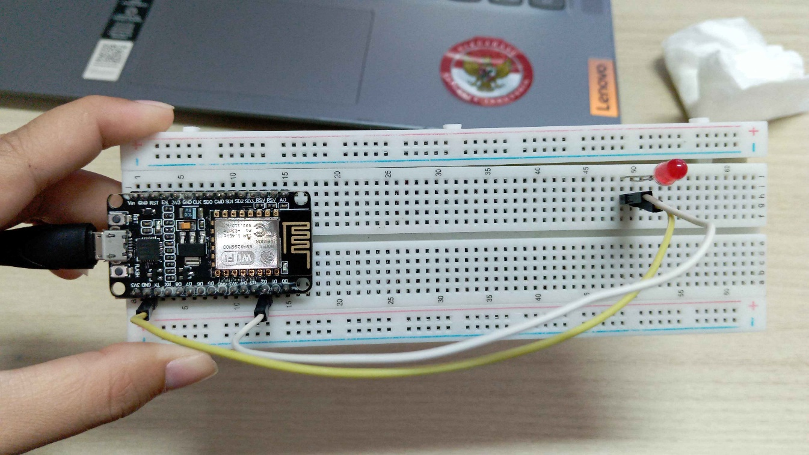
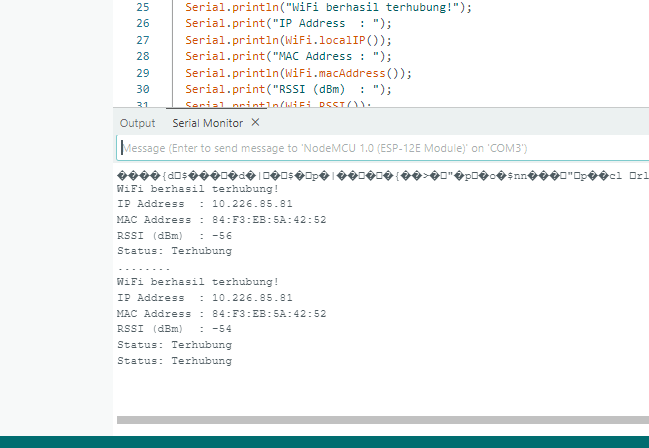
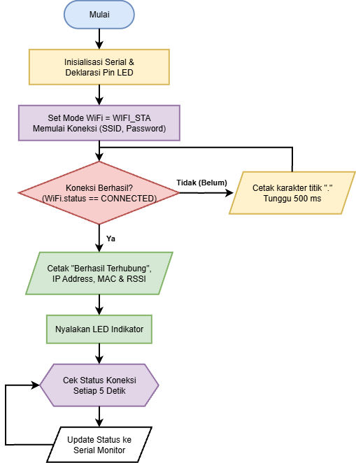

# DOKUMENTASI MODUL 2

Dokumentasi hasil praktikum Konfigurasi Jaringan (WiFi Mode Station dan Access Point):

## 1. Foto Rangkaian Alat ESP8266 / NodeMCU & LED Indikator

*Gambar 1: Rangkaian hardware mikrokontroler NodeMCU ESP-12E / ESP32 yang terhubung ke breadboard dengan LED indikator status koneksi.*

---

## 2. Screenshot Output Serial Monitor (Mode Station Berhasil Terhubung)

*Gambar 2: Hasil output Serial Monitor saat perangkat sukses tersambung ke jaringan WiFi (menampilkan IP lokal 10.224.85.81, MAC Address 84:F3:EB:5A:42:52, dan RSSI -56 dBm).*

---

## 3. Diagram Alur (Flowchart) Logika Koneksi Mode Station

*Gambar 3: Flowchart alur inisialisasi WiFi Station, loop verifikasi status WL_CONNECTED, pembacaan parameter jaringan, hingga monitoring berkala.*
