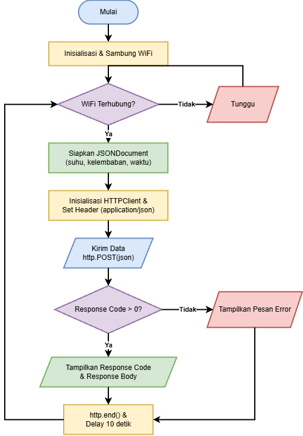

# DOKUMENTASI MODUL 3

Dokumentasi hasil praktikum Protokol Komunikasi IoT (HTTP dan MQTT dengan Format JSON):

## 1. Flowchart Proses Pengiriman Data HTTP POST

*Gambar 1: Diagram alur (flowchart) proses pengiriman data payload JSON melalui metode HTTP POST pada mikrokontroler ESP32 / ESP8266 ke endpoint uji.*

---

## 2. Pengujian Protokol HTTP dan MQTT
* Pengujian HTTP POST dilakukan dengan mengirimkan payload JSON `{"suhu": 28.5, "kelembaban": 65.0}` ke server endpoint publik `http://httpbin.org/post`, yang mengembalikan kode status respon **HTTP 200 (OK)** beserta echo data payload.
* Pengujian MQTT dilakukan dengan mempublikasikan data format JSON ke broker publik `broker.hivemq.com:1883` pada topic `apipdivahana`, dan diverifikasi secara langsung menggunakan MQTT client subscriber.
