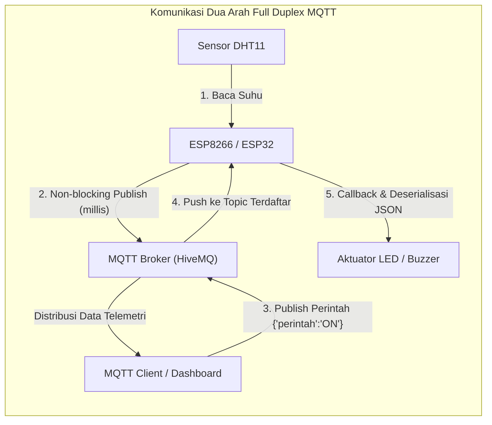
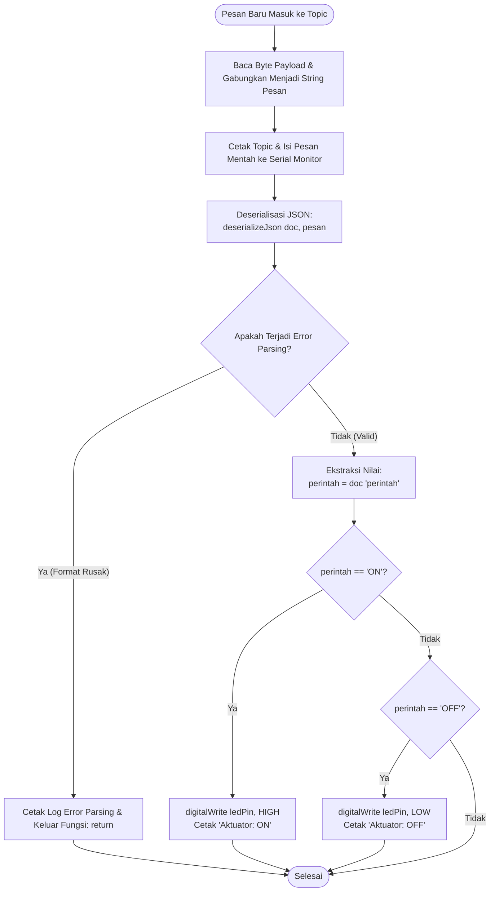

# Laporan Praktikum Internet of Things — Modul 4: Komunikasi Pertukaran Data
**Pertukaran Data Dua Arah (Publish dan Subscribe) pada ESP8266 / ESP32**

---

### Informasi Praktikan
* **Nama** : Afif Nur Rahman
* **NIM** : H1H024016
* **Mata Kuliah** : Praktikum Internet of Things (TK245005)
* **Tahun / Semester** : 2026 / 5 (Genap)
* **Modul** : Modul 4 — Komunikasi Pertukaran Data: Pertukaran Data Dua Arah (Publish dan Subscribe)
* **Nama Asisten / NIM** : Athallah Tsany Satriyaji
* **Program Studi** : S1 Teknik Komputer
* **Fakultas / Universitas** : Fakultas Teknik, Universitas Jenderal Soedirman

---

## Daftar Isi
1. [Detail dan Ringkasan Percobaan](#1-detail-dan-ringkasan-percobaan)
   * [1.1 Tujuan Praktikum](#11-tujuan-praktikum)
   * [1.2 Dasar Teori](#12-dasar-teori)
   * [1.3 Alat dan Bahan](#13-alat-dan-bahan)
2. [Library dan Dependencies yang Diperlukan](#2-library-dan-dependencies-yang-diperlukan)
3. [Percobaan 4A: Subscribe dan Deserialisasi Data JSON untuk Kendali Aktuator](#3-percobaan-4a-subscribe-dan-deserialisasi-data-json-untuk-kendali-aktuator)
   * [3.1 Penjelasan Kode Base Percobaan 4A](#31-penjelasan-kode-base-percobaan-4a)
   * [3.2 Jawaban Pertanyaan Praktikum 4A](#32-jawaban-pertanyaan-praktikum-4a)
   * [3.3 Modifikasi Kode Percobaan 4A (Pengaturan Kecerahan LED via PWM)](#33-modifikasi-kode-percobaan-4a-pengaturan-kecerahan-led-via-pwm)
   * [3.4 Penjelasan Baris demi Baris Kode Modifikasi 4A](#34-penjelasan-baris-demi-baris-kode-modifikasi-4a)
   * [3.5 Penjelasan Fungsi yang Digunakan pada Percobaan 4A](#35-penjelasan-fungsi-yang-digunakan-pada-percobaan-4a)
   * [3.6 Penjelasan Percabangan / Conditional Logic pada Percobaan 4A](#36-penjelasan-percabangan--conditional-logic-pada-percobaan-4a)
4. [Percobaan 4B: Pertukaran Data Dua Arah (Publish dan Subscribe Secara Bersamaan)](#4-percobaan-4b-pertukaran-data-dua-arah-publish-dan-subscribe-secara-bersamaan)
   * [4.1 Penjelasan Kode Base Percobaan 4B](#41-penjelasan-kode-base-percobaan-4b)
   * [4.2 Jawaban Pertanyaan Praktikum 4B](#42-jawaban-pertanyaan-praktikum-4b)
   * [4.3 Modifikasi Kode Percobaan 4B (Dua Topic Perintah - LED & Buzzer)](#43-modifikasi-kode-percobaan-4b-dua-topic-perintah---led--buzzer)
   * [4.4 Penjelasan Baris demi Baris Kode Modifikasi 4B](#44-penjelasan-baris-demi-baris-kode-modifikasi-4b)
   * [4.5 Penjelasan Fungsi yang Digunakan pada Percobaan 4B](#45-penjelasan-fungsi-yang-digunakan-pada-percobaan-4b)
   * [4.6 Penjelasan Percabangan / Conditional Logic pada Percobaan 4B](#46-penjelasan-percabangan--conditional-logic-pada-percobaan-4b)
5. [Jawaban Pertanyaan Analisis (Bagian 4.7 Modul)](#5-jawaban-pertanyaan-analisis-bagian-47-modul)
6. [Catatan Kendala dan Solusi](#6-catatan-kendala-dan-solusi)
7. [Dokumentasi Praktikum](#7-dokumentasi-praktikum)

---

## 1. Detail dan Ringkasan Percobaan

### 1.1 Tujuan Praktikum
Berdasarkan modul praktikum dan logbook, tujuan pembelajaran Modul 4 adalah:
1. Memahami konsep pertukaran data dua arah (*bidirectional / full duplex*) pada ekosistem *Internet of Things* (IoT).
2. Memahami mekanisme penerimaan pesan (*subscribe*) dan proses penguraian data (*deserialisasi*) JSON pada mikrokontroler ESP8266 / ESP32.
3. Mengimplementasikan penerimaan perintah kendali dari broker MQTT untuk menggerakkan perangkat aktuator secara seketika (*real-time*).
4. Mengimplementasikan arsitektur sistem IoT yang mampu mempublikasikan data telemetri sensor (akuisisi) dan menerima instruksi perintah kendali secara simultan tanpa saling mengunci (*non-blocking*).
5. Mampu menganalisis efisiensi dan keandalan mekanisme pertukaran data IoT secara menyeluruh pada sistem yang saling terhubung.

### 1.2 Dasar Teori
Pada Modul 3, mikrokontroler diimplementasikan sebagai *Publisher* (komunikasi satu arah: *sensor $\rightarrow$ broker*). Pada aplikasi industri nyata, sistem IoT harus bekerja secara **dua arah (*bidirectional*)**: selain mengirimkan kondisi lingkungan, sistem harus dapat dikendalikan dari jarak jauh oleh pengguna atau algoritma *cloud*.



#### A. Mekanisme Subscribe pada MQTT
Berbeda dengan *publish* yang bersifat aktif mengirimkan paket, mekanisme *subscribe* bersifat pasif (menunggu data datang dari broker):
* **Fungsi Callback (`client.setCallback(callback)`)**: Fungsi *event-driven* yang didaftarkan ke library MQTT. Fungsi ini akan dipanggil secara otomatis oleh sistem setiap kali ada paket pesan baru masuk pada topic yang didaftarkan.
* **Subscription (`client.subscribe(topic)`)**: Perintah untuk memberi tahu broker bahwa mikrokontroler ingin berlangganan pesan pada topik tertentu.
* **Keep-Alive Loop (`client.loop()`)**: Fungsi yang wajib dipanggil secara rutin di dalam `loop()`. Fungsi ini bertugas menjaga soket TCP tetap hidup dan memproses antrean pesan yang masuk dari broker.

#### B. Deserialisasi Data JSON
Jika pada Modul 3 dipelajari proses **serialisasi** (mengubah objek data C++ menjadi teks string untuk dikirim), maka pada Modul 4 dipelajari proses sebaliknya, yaitu **deserialisasi** (mengurai string teks JSON mentah dari payload MQTT menjadi objek data yang dapat diakses elemen nilainya melalui `doc["key"]`). Pustaka `ArduinoJson` menyediakan fungsi:
```cpp
DeserializationError error = deserializeJson(doc, pesan);
```

#### C. Arsitektur Non-Blocking dengan `millis()`
Pada sistem *Full Duplex*, penggunaan fungsi `delay()` adalah pantangan fatal karena `delay()` bersifat *blocking* (membekukan CPU). Jika program membeku di `delay(5000)`, fungsi `client.loop()` tidak akan berjalan, sehingga perintah kendali dari pengguna akan tertahan (lag) dan koneksi broker MQTT rawan putus (*timeout*).  
Solusinya adalah pendekatan **non-blocking** menggunakan perbandingan waktu `millis()`, di mana CPU dapat mengeksekusi pengiriman data berkala sekaligus memeriksa pesan masuk di setiap siklus tanpa jeda henti.

### 1.3 Alat dan Bahan
* **Board Mikrokontroler**: NodeMCU ESP8266 (ESP-12E Module) / ESP32 DevKit V1 (1 buah).
* **Sensor**: Sensor Suhu dan Kelembaban DHT11 (1 buah).
* **Aktuator**: LED 5mm (simulasi aktuator 1), Resistor 220 $\Omega$, dan Buzzer aktif 5V (simulasi aktuator 2).
* **Peralatan Prototyping**: Breadboard dan kabel jumper (male-to-male secukupnya).
* **Kabel USB**: Kabel Micro-USB untuk catu daya dan komunikasi serial UART.
* **Perangkat Lunak**: Arduino IDE terpasang library `ArduinoJson`, `PubSubClient`, dan `DHT sensor library`.
* **Aplikasi Penguji MQTT**: *MQTT Explorer* atau *HiveMQ WebSocket Client*.
* **Broker Publik**: `broker.hivemq.com` (Port 1883).

---

## 2. Library dan Dependencies yang Diperlukan

Untuk mengompilasi program Modul 4, diperlukan pustaka-pustaka berikut pada Arduino IDE:

| Nama Pustaka | Pembuat / Pengembang | Versi | Fungsi Utama |
|---|---|---|---|
| **PubSubClient** | Nick O'Leary | 2.8+ | Menangani protokol MQTT, manajemen soket TCP, subscription, dan callback. |
| **ArduinoJson** | Benoit Blanchon | Versi 7.x / 6.x | Parsing dan deserialisasi payload JSON yang diterima dari broker MQTT. |
| **DHT sensor library** | Adafruit | 1.4+ | Membaca data temperatur dan kelembaban dari pin digital sensor DHT11/DHT22. |
| **ESP8266WiFi / WiFi** | ESP8266 Community / Espressif | Built-in | Konektivitas nirkabel WiFi 2.4 GHz ke Access Point/Internet. |

### Konfigurasi Multi-Platform C++
```cpp
#if defined(ESP8266)
  #include <ESP8266WiFi.h>
  #define DHTPIN D2
  const int ledPin = D7; // Pin LED NodeMCU (GPIO 13)
#elif defined(ESP32)
  #include <WiFi.h>
  #define DHTPIN 4
  const int ledPin = 26; // Pin LED ESP32 (GPIO 26)
#endif
#include <PubSubClient.h>
#include <ArduinoJson.h>
#include <DHT.h>
```

---

## 3. Percobaan 4A: Subscribe dan Deserialisasi Data JSON untuk Kendali Aktuator

### 3.1 Penjelasan Kode Base Percobaan 4A
File implementasi: [`code/percobaan4A.cpp`](file:///c:/KULIAHHHHHHHHH/TUGAS%20KULIAH/SEMESTER%205/PRAKTIKUM%20IOT/REPO%20GIT/H1H024016-AFIF_NUR_RAHMAN-PRAKTIKUM_INTERNET_OF_THINGS/Pertemuan%204/code/percobaan4A.cpp)

Pada percobaan ini:
1. ESP terhubung ke broker HiveMQ dan mendaftarkan langganan (*subscribe*) ke topic perintah `unsoed/tk245004/kelompokapiphana/perintah`.
2. Saat ada pesan masuk, broker menembakkan data ke fungsi `callback()`.
3. Byte array `payload` dirangkai menjadi objek `String pesan`.
4. Fungsi `deserializeJson(doc, pesan)` menguraikan struktur string menjadi format JSON.
5. Nilai kunci `doc["perintah"]` diperiksa:
   * Jika `"ON"` $\rightarrow$ `digitalWrite(ledPin, HIGH)` (LED Menyala).
   * Jika `"OFF"` $\rightarrow$ `digitalWrite(ledPin, LOW)` (LED Padam).

---

### 3.2 Jawaban Pertanyaan Praktikum 4A

#### 1. Gambarkan diagram alur (flowchart) proses penerimaan dan pemrosesan pesan pada fungsi callback di atas!

Diagram alur penanganan pesan pada fungsi callback divisualisasikan sebagai berikut:



> Diagram alir dari catatan praktikum dapat dilihat pada file: [`dokumentasi/flowchart_callback.png`](file:///c:/KULIAHHHHHHHHH/TUGAS%20KULIAH/SEMESTER%205/PRAKTIKUM%20IOT/REPO%20GIT/H1H024016-AFIF_NUR_RAHMAN-PRAKTIKUM_INTERNET_OF_THINGS/Pertemuan%204/dokumentasi/flowchart_callback.png).

---

#### 2. Apa yang akan terjadi apabila pesan yang dipublikasikan bukan merupakan format JSON yang valid?
Apabila pesan yang dipublikasikan bukan format JSON yang valid (misal hanya teks mentah `"NYALAKAN"` atau JSON rusak seperti `{"perintah":` tanpa kurung tutup):
1. Fungsi `deserializeJson(doc, pesan)` akan mengembalikan kode error `DeserializationError::InvalidInput` (atau `DeserializationError::IncompleteInput`).
2. Kondisi percabangan `if (error)` akan bernilai **`true`**.
3. Program akan mencetak pesan kegagalan ke Serial Monitor (`Gagal parsing JSON: IncompleteInput`) lalu mengeksekusi perintah **`return;`** untuk menghentikan proses fungsi `callback()` saat itu juga.
4. **Dampaknya:** Aktuator tidak akan berubah statusnya (aman dari tindakan salah), variabel tidak crash, dan sistem mikrokontroler tetap berjalan normal tanpa mengalami *system freeze* atau *kernel panic/reboot*.

---

#### 3. Jelaskan mengapa fungsi `client.subscribe()` dipanggil di dalam fungsi `hubungkanMQTT()`, bukan di dalam `setup()`!
* **Alasan Teknis Sesi Koneksi:**
  Pada protokol MQTT, status langganan (*subscription table*) terikat langsung pada **sesi koneksi soket TCP yang aktif** antara klien dan broker. 
* **Jika dipanggil di `setup()`:**  
  Perintah `client.subscribe()` hanya akan dieksekusi **satu kali** saat perangkat pertama kali dinyalakan. Jika beberapa menit kemudian koneksi internet terputus atau router restart, ESP akan melakukan *reconnect* ke broker. Namun setelah tersambung kembali, **broker telah menghapus daftar langganan lama**. Akibatnya, ESP tidak akan pernah menerima perintah kendali lagi sampai tombol reset fisik ditekan!
* **Keuntungan dipanggil di `hubungkanMQTT()`:**  
  Setiap kali mikrokontroler berhasil melakukan *reconnect* (menyambung ulang) setelah koneksi terputus, ESP akan **secara otomatis mendaftarkan ulang (*re-subscribe*)** topic perintah ke broker, memastikan sistem kendali selalu responsif tanpa intervensi manual.

---

### 3.3 Modifikasi Kode Percobaan 4A (Pengaturan Kecerahan LED via PWM)

#### Soal Modifikasi Modul:
> **"Modifikasi program agar data JSON yang diterima juga memuat nilai intensitas (misalnya `{"perintah": "ON", "intensitas": 200}`) yang digunakan untuk mengatur kecerahan LED menggunakan PWM (analogWrite/ledcWrite), dan berikan penjelasan di setiap baris kode yang ditambahkan dalam bentuk README.md"**

File implementasi: [`code/percobaan4A_modifikasi.cpp`](file:///c:/KULIAHHHHHHHHH/TUGAS%20KULIAH/SEMESTER%205/PRAKTIKUM%20IOT/REPO%20GIT/H1H024016-AFIF_NUR_RAHMAN-PRAKTIKUM_INTERNET_OF_THINGS/Pertemuan%204/code/percobaan4A_modifikasi.cpp)

Bagian modifikasi utama pada fungsi `callback()`:
```cpp
void callback(char* topic, byte* payload, unsigned int length) {
  String pesan;
  for (unsigned int i = 0; i < length; i++) pesan += (char)payload[i];

  JsonDocument doc;
  DeserializationError error = deserializeJson(doc, pesan);
  if (error) return;

  const char* perintah = doc["perintah"];

  // === BARIS MODIFIKASI: EKSTRAKSI INTENSITAS PWM ===
  int intensitas = doc["intensitas"] | 0; // Default 0 jika kunci tidak ada

  if (String(perintah) == "ON") {
    #if defined(ESP8266)
      // ESP8266 analogWrite resolusi 10-bit (0 - 1023)
      analogWrite(ledPin, intensitas > 0 ? intensitas : 1023);
    #elif defined(ESP32)
      // ESP32 ledcWrite resolusi 8-bit (0 - 255)
      ledcWrite(pwmChannel, intensitas > 0 ? intensitas : 255);
    #endif
    Serial.print("Aktuator: ON dengan intensitas PWM: ");
    Serial.println(intensitas);
  } else if (String(perintah) == "OFF") {
    #if defined(ESP8266)
      analogWrite(ledPin, 0);
    #elif defined(ESP32)
      ledcWrite(pwmChannel, 0);
    #endif
    Serial.println("Aktuator: OFF (Intensitas 0)");
  }
}
```

---

### 3.4 Penjelasan Baris demi Baris Kode Modifikasi 4A
1. **`int intensitas = doc["intensitas"] | 0;`**  
   Mengekstraksi nilai numerik integer dari *key* `"intensitas"` pada objek JSON. Operator bitwise OR (`| 0`) bertindak sebagai mekanisme *fallback/default*: jika pengirim hanya mengirim `{"perintah":"ON"}` tanpa menyertakan kunci `"intensitas"`, variabel secara aman akan bernilai `0` tanpa menyebabkan error *null pointer*.
2. **`analogWrite(ledPin, intensitas > 0 ? intensitas : 1023);` (pada ESP8266)**  
   Mengatur tingkat kecerahan LED menggunakan sinyal modulasi lebar pulsa (*PWM / analogWrite*). Rentang PWM bawaan ESP8266 adalah 10-bit ($0 - 1023$). Operator *ternary* memastikan jika nilai intensitas yang dikirim di atas 0, nilai tersebut yang digunakan; jika 0, lampu dinyalakan pada kecerahan penuh (1023).
3. **`ledcWrite(pwmChannel, intensitas > 0 ? intensitas : 255);` (pada ESP32)**  
   Pada arsitektur ESP32, fungsi PWM menggunakan kontroler perangkat keras LEDC (*LED Control*) beresolusi 8-bit ($0 - 255$).
4. **`analogWrite(ledPin, 0);` / `ledcWrite(pwmChannel, 0);`**  
   Ketika perintah bernilai `"OFF"`, *duty cycle* sinyal PWM diset ke angka 0 untuk mematikan aliran arus listrik ke LED secara total.

---

### 3.5 Penjelasan Fungsi yang Digunakan pada Percobaan 4A

| Nama Fungsi | Parameter Masukan | Return Value | Penjelasan Kegunaan Teknis |
|---|---|---|---|
| `client.setCallback(fn)` | `callback` (fungsi pointer) | `PubSubClient&` | Mendaftarkan fungsi penanganan *event* pesan masuk dari broker MQTT. |
| `deserializeJson(doc, input)`| `JsonDocument&`, `String` | `DeserializationError` | Mengurai teks string mentah menjadi objek pohon dokumen JSON di memori RAM. |
| `doc["key"]` | Nama kunci string | `JsonVariant` | Mengakses dan membaca nilai elemen data pada objek JSON yang telah dideserialisasi. |
| `analogWrite(pin, val)` | `ledPin`, nilai integer (0-1023) | `void` | Menghasilkan sinyal PWM frekuensi 1 kHz untuk mengatur kecerahan pin keluaran pada ESP8266. |
| `client.subscribe(topic)` | `const char* topic` | `bool` | Mengirimkan paket kontrol MQTT `SUBSCRIBE` ke broker untuk berlangganan topic tertentu. |

---

### 3.6 Penjelasan Percabangan / Conditional Logic pada Percobaan 4A
1. **Validasi Deserialisasi `if (error)`**:
   Mengecek apakah status parsing berhasil. Mencegah program mengeksekusi manipulasi data terhadap objek kosong/rusak.
2. **Evaluasi Perintah String `if (String(perintah) == "ON") ... else if (...)`**:
   Mencocokkan nilai teks perintah yang diekstrak dari JSON untuk menentukan aksi fisik perangkat keras.
3. **Operator Logika Ternary `intensitas > 0 ? intensitas : 1023`**:
   Memberikan nilai fleksibel: jika pengguna mengirim parameter kecerahan spesifik, nilai tersebut yang diterapkan; jika tidak, diterapkan kecerahan maksimal bawaan.

---

---

## 4. Percobaan 4B: Pertukaran Data Dua Arah (Publish dan Subscribe Secara Bersamaan)

### 4.1 Penjelasan Kode Base Percobaan 4B
File implementasi: [`code/percobaan4B.cpp`](file:///c:/KULIAHHHHHHHHH/TUGAS%20KULIAH/SEMESTER%205/PRAKTIKUM%20IOT/REPO%20GIT/H1H024016-AFIF_NUR_RAHMAN-PRAKTIKUM_INTERNET_OF_THINGS/Pertemuan%204/code/percobaan4B.cpp)

Pada percobaan ini:
1. ESP menjalankan arsitektur **Full Duplex**: mempublikasikan data suhu DHT11 ke `topicData` setiap 5 detik, dan berlangganan perintah ke `topicPerintah`.
2. Pengiriman data suhu dirancang secara **non-blocking** menggunakan perbandingan waktu `millis()`, sehingga `loop()` tidak pernah terhenti oleh `delay()`.
3. Di saat mikrokontroler sedang menghitung jeda waktu pengiriman suhu, fungsi `client.loop()` tetap aktif berjalan ratusan kali per detik. Ketika pengguna mengirim perintah ON/OFF melalui MQTT Explorer, perintah tersebut dieksekusi secara instan (< 100 ms) tanpa menunggu siklus pengiriman data suhu selesai.

---

### 4.2 Jawaban Pertanyaan Praktikum 4B

#### 1. Mengapa penggunaan `delay()` yang lama sebaiknya dihindari pada program yang menggabungkan proses publish dan subscribe secara bersamaan?
Fungsi `delay()` bekerja dengan cara menahan (*membekukan / blocking*) seluruh eksekusi siklus clock CPU mikrokontroler. 

Jika program menggunakan `delay(5000)`:
1. **Perintah Kendali Mengalami Lag Parah**: Fungsi `client.loop()` tidak akan pernah dipanggil selama 5 detik penuh. Akibatnya, jika ada pengguna menekan tombol ON di aplikasi MQTT Explorer, mikrokontroler tidak akan merespons sampai delay selesai.
2. **Koneksi Broker Terputus (*Keep-Alive Timeout*)**: Paket PING MQTT (*Keep-Alive Ping*) tidak dapat dikirim tepat waktu, sehingga broker publik akan menganggap ESP telah mati (*offline*) dan memutus sambungan soket TCP secara sepihak.

---

#### 2. Jelaskan cara kerja mekanisme non-blocking menggunakan fungsi `millis()` pada program di atas!
Mekanisme *non-blocking* bekerja layaknya **jam tangan**:
1. Program mendeklarasikan variabel penanda waktu `unsigned long waktuTerakhirPublish = 0;` dan interval target `const long intervalPublish = 5000;`.
2. Pada setiap perputaran `loop()`, mikrokontroler menghitung selisih waktu:
   $$\Delta t = \text{millis}() - \text{waktuTerakhirPublish}$$
3. **Jika $\Delta t < 5000\text{ ms}$**: Program mengabaikan blok pengiriman sensor dan **langsung lanjut** mengeksekusi instruksi berikutnya, yaitu `client.loop()`, menjaga responsivitas aktuator tetap instan.
4. **Jika $\Delta t \ge 5000\text{ ms}$**: Waktu 5 detik telah terpenuhi. Program memperbarui catatan waktu `waktuTerakhirPublish = millis()`, membaca sensor DHT11, lalu mempublikasikan data JSON ke broker.

---

#### 3. Apa yang akan terjadi apabila fungsi `client.loop()` jarang dipanggil (misalnya hanya sekali setiap 10 detik)?
1. **Tingginya Latensi Kendali (*High Latency*)**: Waktu respon penerimaan perintah akan tertunda antara 0 hingga 10 detik tergantung kapan perintah tersebut tiba di broker relatif terhadap panggilan `client.loop()`.
2. **Buffer Jaringan Meluap (*Socket Buffer Overflow*)**: Paket-paket data yang menumpuk di buffer TCP penerima dapat menyebabkan paket hilang (*packet dropped*).
3. **Pemutusan Koneksi oleh Broker**: Batas waktu *Keep-Alive* standar pada library `PubSubClient` adalah **15 detik**. Jika jeda pemanggilan bertambah sedikit saja melewati 15 detik, broker MQTT akan menyatakan sesi *expired* dan memutuskan koneksi secara paksa.

---

### 4.3 Modifikasi Kode Percobaan 4B (Dua Topic Perintah - LED & Buzzer)

#### Soal Modifikasi Modul:
> **"Modifikasi program agar menambahkan satu topic perintah baru untuk mengendalikan aktuator kedua (misalnya buzzer), dengan fungsi callback yang dapat membedakan topic mana yang menerima pesan, dan berikan penjelasan di setiap baris kode yang ditambahkan dalam bentuk README.md!"**

File implementasi: [`code/percobaan4B_modifikasi.cpp`](file:///c:/KULIAHHHHHHHHH/TUGAS%20KULIAH/SEMESTER%205/PRAKTIKUM%20IOT/REPO%20GIT/H1H024016-AFIF_NUR_RAHMAN-PRAKTIKUM_INTERNET_OF_THINGS/Pertemuan%204/code/percobaan4B_modifikasi.cpp)

```cpp
// Kredensial topic terpisah
const char* topicLED    = "unsoed/tk245004/kelompokapiphana/perintah/led";
const char* topicBuzzer = "unsoed/tk245004/kelompokapiphana/perintah/buzzer";
const int buzzerPin     = D5; // Pin Buzzer pada NodeMCU (atau GPIO 18 pada ESP32)

void callback(char* topic, byte* payload, unsigned int length) {
  String pesan;
  for (unsigned int i = 0; i < length; i++) pesan += (char)payload[i];

  JsonDocument doc;
  if (deserializeJson(doc, pesan)) return;
  const char* perintah = doc["perintah"];

  // === BARIS MODIFIKASI: PEMILAHAN TOPIC DENGAN strcmp() ===
  // 1. Memeriksa apakah pesan masuk ditujukan ke topic LED
  if (strcmp(topic, topicLED) == 0) {
    digitalWrite(ledPin, String(perintah) == "ON" ? HIGH : LOW);
    Serial.println("Perintah dieksekusi pada LED");
  } 
  // 2. Memeriksa apakah pesan masuk ditujukan ke topic Buzzer
  else if (strcmp(topic, topicBuzzer) == 0) {
    digitalWrite(buzzerPin, String(perintah) == "ON" ? HIGH : LOW);
    Serial.println("Perintah dieksekusi pada Buzzer");
  }
}

void hubungkanMQTT() {
  while (!client.connected()) {
    String clientId = "ESPClient-" + String(random(0xffff), HEX);
    if (client.connect(clientId.c_str())) {
      // Mendaftarkan langganan ke kedua topic sekaligus
      client.subscribe(topicLED);
      client.subscribe(topicBuzzer);
      Serial.println("Terhubung dan subscribe ke topic LED & Buzzer!");
    } else {
      delay(2000);
    }
  }
}
```

---

### 4.4 Penjelasan Baris demi Baris Kode Modifikasi 4B
1. **`const char* topicLED = ".../perintah/led"; const char* topicBuzzer = ".../perintah/buzzer";`**  
   Mendefinisikan dua alamat topic MQTT yang spesifik dan terpisah untuk masing-masing aktuator.
2. **`const int buzzerPin = D5;`**  
   Menetapkan pin GPIO mikrokontroler (pin D5 / GPIO 14 pada NodeMCU atau GPIO 18 pada ESP32) yang terhubung ke pin sinyal basis transistor/modul Buzzer.
3. **`if (strcmp(topic, topicLED) == 0)`**  
   Fungsi `strcmp()` (*string compare*) dari bahasa C digunakan untuk membandingkan string nama topic yang sedang memicu *callback* dengan konstanta `topicLED`. Jika kedua teks identik, fungsi mengembalikan nilai `0`. Perintah di dalamnya akan menyalakan/mematikan pin LED.
4. **`else if (strcmp(topic, topicBuzzer) == 0)`**  
   Jika topic yang memicu callback cocok dengan `topicBuzzer`, logika akan mengeksekusi `digitalWrite(buzzerPin, ...)` untuk mengendalikan bunyi buzzer aktif.
5. **`client.subscribe(topicLED); client.subscribe(topicBuzzer);`**  
   Pada fungsi koneksi MQTT, mikrokontroler mendaftarkan diri secara berurutan ke kedua topic tersebut agar broker HiveMQ meneruskan paket perintah dari kedua alamat topic ke ESP.

---

### 4.5 Penjelasan Fungsi yang Digunakan pada Percobaan 4B

| Nama Fungsi | Parameter Masukan | Return Value | Penjelasan Kegunaan Teknis |
|---|---|---|---|
| `millis()` | *None* | `unsigned long` | Mengambil nilai counter pewaktu internal sejak perangkat hidup dalam satuan ms. |
| `dht.readTemperature()` | *None* | `float` | Mengambil data suhu digital dari sensor DHT11. |
| `isnan(val)` | Nilai float | `bool` | Memeriksa apakah nilai pembacaan sensor gagal (*Not a Number*). |
| `strcmp(str1, str2)` | Dua pointer string `char*` | `int` (0 jika identik) | Membandingkan kesamaan teks secara leksikografis antara dua string array. |
| `client.publish(topic, payload)`| Nama topic, char buffer | `bool` | Mengirimkan paket publikasi data telemetri ke broker MQTT. |

---

### 4.6 Penjelasan Percabangan / Conditional Logic pada Percobaan 4B
1. **Percabangan Pewaktu Non-Blocking `if (millis() - waktuTerakhirPublish > intervalPublish)`**:
   Mengeksekusi blok kode pengiriman data sensor hanya jika interval waktu 5 detik telah terlewati, tanpa memblokir alur CPU di luar interval.
2. **Validasi Sensor `if (!isnan(suhu))`**:
   Menjamin data yang dipublikasikan ke broker adalah angka suhu yang valid, bukan data korup akibat gangguan koneksi fisik sensor.
3. **Percabangan Pemilihan Topik Multi-Aktuator `strcmp()`**:
   Memisahkan eksekusi aktuator sehingga instruksi yang ditujukan untuk LED tidak akan memicu Buzzer secara keliru.

---

---

## 5. Jawaban Pertanyaan Analisis (Bagian 4.7 Modul)

### 1. Uraikan hasil tugas pada praktikum yang telah dilakukan pada setiap percobaan!

#### Tabel 4.1: Hasil Penerimaan dan Pemrosesan Perintah MQTT (Percobaan 4A)
| No. | Perintah JSON | Pesan Diterima | Hasil Parsing | Status LED Fisik | Keterangan |
|:---:|:---|:---|:---:|:---:|:---|
| 1 | `{"perintah":"ON"}` | `{"perintah":"ON"}` | `ON` | **Menyala** | LED berubah menyala setelah perintah ON diterima. |
| 2 | `{"perintah":"OFF"}` | `{"perintah":"OFF"}` | `OFF` | **Mati** | LED berubah mati setelah perintah OFF diterima. |
| 3 | `{"perintah":"ON"}` | `{"perintah":"ON"}` | `ON` | **Menyala** | Respon instan, aktuasi berhasil. |
| 4 | `{"perintah":"OFF"}` | `{"perintah":"OFF"}` | `OFF` | **Mati** | Respon instan, aktuasi berhasil. |
| 5 | `{"perintah":"ON"}` | `{"perintah":"ON"}` | `ON` | **Menyala** | Deserialisasi data konsisten tanpa error. |

#### Tabel 4.2: Hasil Pertukaran Data Dua Arah / Full Duplex (Percobaan 4B)
| No. | Waktu Pengiriman (s) | Data Suhu Dipublish | Perintah Diterima | Status LED | Data Diterima Subscriber | Keterangan |
|:---:|:---:|:---|:---:|:---:|:---|:---:|
| 1 | 0 | `{"suhu":28}` | — | — | `{"suhu":28}` | Sukses publish pertama |
| 2 | 5 | `{"suhu":28}` | `ON` | **Menyala** | `{"suhu":28}`, `{"perintah":"ON"}` | Berhasil kirim & terima simultan |
| 3 | 10 | `{"suhu":28}` | — | Menyala | `{"suhu":28}` | Data berkala kontinu |
| 4 | 15 | `{"suhu":28}` | `OFF` | **Mati** | `{"suhu":28}`, `{"perintah":"OFF"}` | LED merespons seketika |
| 5 | 20 | `{"suhu":28}` | — | Mati | `{"suhu":28}` | Sistem stabil |
| 6 | 25 | `{"suhu":28}` | `ON` | **Menyala** | `{"suhu":28}`, `{"perintah":"ON"}` | Full Duplex berjalan lancar |

---

### 2. Bandingkan mekanisme komunikasi satu arah (Modul 3) dengan komunikasi dua arah (Modul 4)!
* **Komunikasi Satu Arah (Modul 3 - Publish Only)**:
  * Mikrokontroler hanya bertindak sebagai pelapor data (*telemetry sender*).
  * Sistem tidak memiliki fungsi `callback()` dan tidak melakukan `client.subscribe()`.
  * Sistem tidak dapat dikontrol dari jarak jauh. Pengguna hanya bisa pasif melihat grafik data di dashboard.
* **Komunikasi Dua Arah (Modul 4 - Publish & Subscribe / Full Duplex)**:
  * Mikrokontroler bertindak sekaligus sebagai pelapor data (*sensor monitoring*) dan pengendali fisik (*remote actuator controller*).
  * Menggunakan dua topic terpisah (topic telemetri dan topic kendali) yang bekerja secara independen di atas satu koneksi soket TCP persisten.
  * Memungkinkan interaksi manusia-ke-mesin (*Human-to-Machine*) dan mesin-ke-mesin (*M2M*) secara dinamis dan *real-time*.

---

### 3. Mengapa pendekatan non-blocking (`millis()`) lebih sesuai dibandingkan pendekatan blocking (`delay()`) pada sistem IoT real-time?
1. **Menghilangkan Jeda Buta (*No Blind-Wait*)**: `delay()` menyita seluruh siklus CPU hanya untuk menunggu waktu habis tanpa melakukan pekerjaan lain. Sedangkan `millis()` hanya membaca pewaktu internal dan langsung membebaskan CPU untuk tugas lain.
2. **Responsivitas Perintah Instan**: Dengan `millis()`, fungsi `client.loop()` dapat dieksekusi ribuan kali per detik, sehingga paket kendali dari broker dapat diproses dengan latensi kurang dari 100 milidetik.
3. **Keandalan Koneksi (*Network Liveness*)**: Sistem non-blocking memastikan paket pertukaran PING (*Keep-Alive*) ke broker tidak pernah terhenti, mencegah broker memutuskan koneksi akibat *timeout*.

---

### 4. Berikan contoh penerapan komunikasi dua arah pada sistem IoT nyata dan jelaskan manfaatnya!
* **Contoh Penerapan: Sistem Pertanian Cerdas (*Smart Green House & Precision Agriculture*)**:
  * **Arah Unggah (Publish)**: Node mikrokontroler di lahan pertanian secara periodik mengirimkan data pembacaan sensor kelembaban tanah (*soil moisture*), intensitas cahaya (LDR), dan temperatur udara ke broker MQTT di cloud.
  * **Arah Unduh (Subscribe)**: Ketika sistem analitik cloud atau petani melalui aplikasi smartphone melihat kelembaban tanah berada di bawah ambang kritis, petani mengirim perintah `{"perintah": "POMPA_ON", "durasi": 60}` ke topik kendali. ESP menerima perintah tersebut dan langsung menyalakan aktuator pompa irigasi serta katup solenoid.
* **Manfaat Dibandingkan Sistem Satu Arah**:
  * Tanpa komunikasi dua arah, perangkat hanya menjadi alat pemantau pasif, sehingga tindakan penanggulangan (seperti tanaman layu akibat kekeringan) harus dilakukan secara manual oleh petani dengan datang langsung ke kebun.
  * Komunikasi dua arah mewujudkan otomasi tertutup (*closed-loop control system*) dari jarak jauh di mana data telemetri dapat langsung ditindaklanjuti dengan aksi nyata.

---

## 6. Catatan Kendala dan Solusi

Berdasarkan pelaksanaan praktikum Modul 4 di laboratorium:
1. **Kerusakan Perangkat Keras Sensor DHT11**:
   * *Kendala*: Pada sesi praktikum, modul sensor DHT11 mengalami kerusakan hardware (*damaged sensor*) sehingga pembacaan sensor bernilai `NaN`.
   * *Solusi*: Pengujian fokus dilakukan secara mendalam pada mekanisme penerimaan perintah kendali (Percobaan 4A) dan simulasi data telemetri suhu statik (Percobaan 4B) untuk memvalidasi kestabilan arsitektur komunikasi *Full Duplex*.
2. **Penetapan Pin Output LED**:
   * *Kendala*: Perbedaan pelabelan pin fisik antara NodeMCU ESP8266 (label D7 memetakan ke GPIO 13, D4 memetakan ke GPIO 2) dan ESP32 (GPIO 26).
   * *Solusi*: Menggunakan konstanta pra-pemrosesan multi-board yang fleksibel dan memastikan koneksi ground (GND) resistor pembatas 220 $\Omega$ terpasang dengan kokoh di breadboard.

---

## 7. Dokumentasi Praktikum

Aset dokumentasi visual hasil pengujian praktikum dapat diakses pada folder: [`dokumentasi/`](file:///c:/KULIAHHHHHHHHH/TUGAS%20KULIAH/SEMESTER%205/PRAKTIKUM%20IOT/REPO%20GIT/H1H024016-AFIF_NUR_RAHMAN-PRAKTIKUM_INTERNET_OF_THINGS/Pertemuan%204/dokumentasi)

* **Flowchart Callback**: [`dokumentasi/flowchart_callback.png`](file:///c:/KULIAHHHHHHHHH/TUGAS%20KULIAH/SEMESTER%205/PRAKTIKUM%20IOT/REPO%20GIT/H1H024016-AFIF_NUR_RAHMAN-PRAKTIKUM_INTERNET_OF_THINGS/Pertemuan%204/dokumentasi/flowchart_callback.png)
* **Pengujian MQTT Explorer & IDE**: [`dokumentasi/mqtt_explorer_arduino_ide.png`](file:///c:/KULIAHHHHHHHHH/TUGAS%20KULIAH/SEMESTER%205/PRAKTIKUM%20IOT/REPO%20GIT/H1H024016-AFIF_NUR_RAHMAN-PRAKTIKUM_INTERNET_OF_THINGS/Pertemuan%204/dokumentasi/mqtt_explorer_arduino_ide.png)
* **Output Serial Monitor**: [`dokumentasi/serial_monitor_output.png`](file:///c:/KULIAHHHHHHHHH/TUGAS%20KULIAH/SEMESTER%205/PRAKTIKUM%20IOT/REPO%20GIT/H1H024016-AFIF_NUR_RAHMAN-PRAKTIKUM_INTERNET_OF_THINGS/Pertemuan%204/dokumentasi/serial_monitor_output.png)
* **README Dokumentasi**: [`dokumentasi/README.md`](file:///c:/KULIAHHHHHHHHH/TUGAS%20KULIAH/SEMESTER%205/PRAKTIKUM%20IOT/REPO%20GIT/H1H024016-AFIF_NUR_RAHMAN-PRAKTIKUM_INTERNET_OF_THINGS/Pertemuan%204/dokumentasi/README.md)
