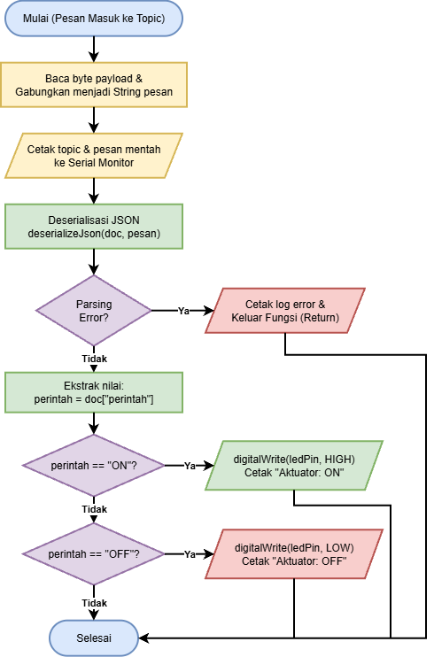
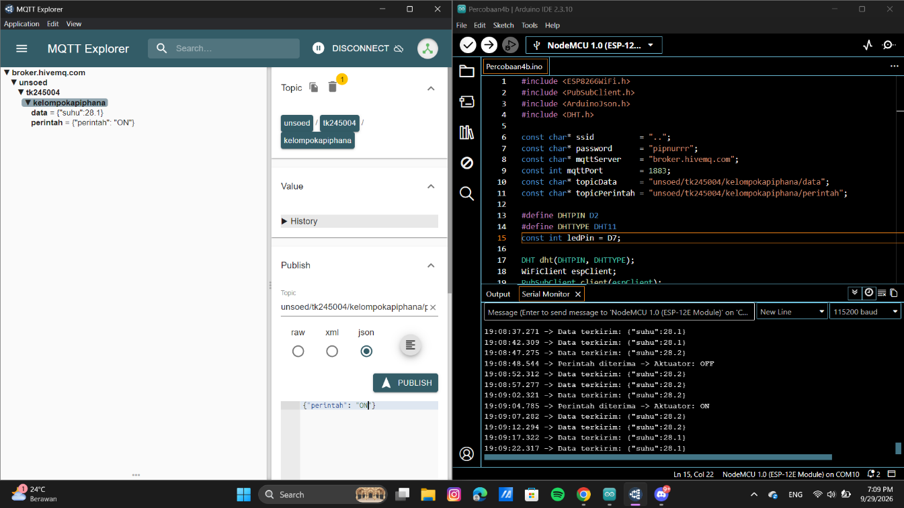
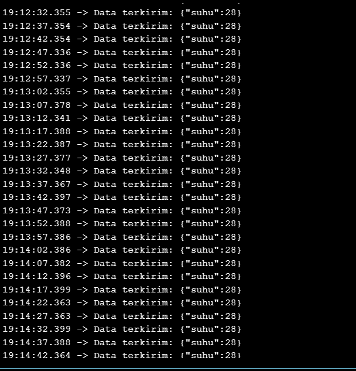

# DOKUMENTASI MODUL 4

Dokumentasi hasil praktikum Komunikasi Pertukaran Data Dua Arah (Publish dan Subscribe):

---

## 1. Flowchart Proses Callback (Penerimaan & Deserialisasi JSON)

*Gambar 1: Diagram alur (flowchart) proses penerimaan pesan MQTT pada fungsi callback, deserialisasi payload JSON menggunakan `deserializeJson()`, validasi error parsing, dan eksekusi status logika pin aktuator.*

---

## 2. Pengujian MQTT Explorer & Arduino IDE

*Gambar 2: Pengujian pertukaran data dua arah secara simultan (Full Duplex). Terlihat mikrokontroler mempublikasikan data suhu ke topic `unsoed/tk245004/kelompokapiphana/data` dan secara bersamaan menerima perintah kendali ON/OFF pada topic `unsoed/tk245004/kelompokapiphana/perintah` melalui MQTT Explorer.*

---

## 3. Log Output Serial Monitor

*Gambar 3: Log pengiriman data sensor secara berkala setiap 5 detik berbasis non-blocking `millis()` yang berjalan stabil dan berkelanjutan tanpa hambatan.*
