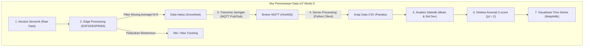
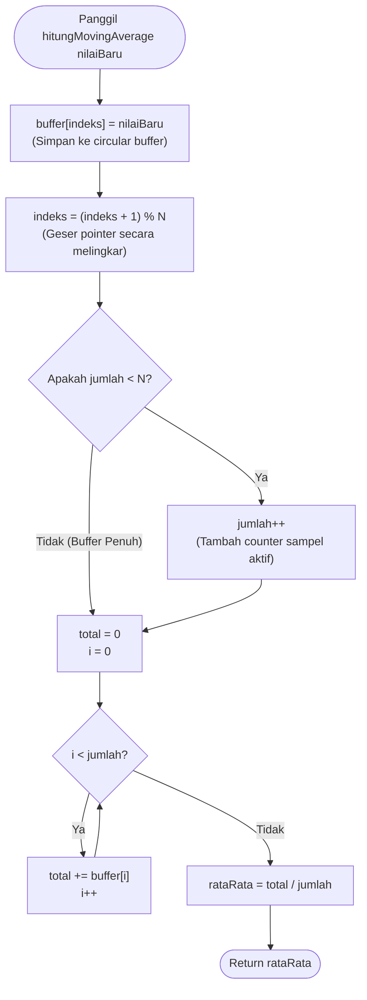
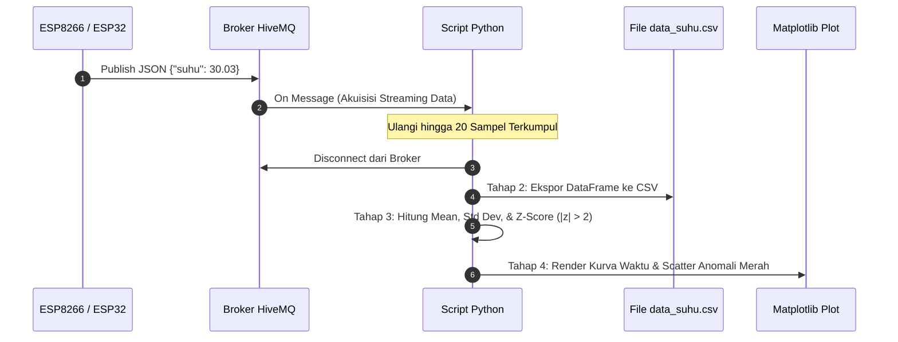

# Laporan Praktikum Internet of Things — Modul 5: Pemrosesan Data Sensor dan Analisis Statistik
**Pengolahan Data Edge (ESP32/ESP8266) dan Server Processing (Python, MQTT, CSV, Z-Score, & Visualisasi)**

---

### Informasi Praktikan
* **Nama** : Afif Nur Rahman
* **NIM** : H1H024016
* **Mata Kuliah** : Praktikum Internet of Things (TK245005)
* **Tahun / Semester** : 2026 / 5 (Genap)
* **Modul** : Modul 5 — Pemrosesan Data Sensor dan Analisis Statistik
* **Nama Asisten / NIM** : Athallah Tsany Satriyaji
* **Program Studi** : S1 Teknik Komputer
* **Fakultas / Universitas** : Fakultas Teknik, Universitas Jenderal Soedirman

---

## Daftar Isi
1. [Detail dan Ringkasan Percobaan](#1-detail-dan-ringkasan-percobaan)
   * [1.1 Tujuan Praktikum](#11-tujuan-praktikum)
   * [1.2 Dasar Teori](#12-dasar-teori)
   * [1.3 Alat dan Bahan](#13-alat-dan-bahan)
2. [Library dan Dependencies yang Diperlukan](#2-library-dan-dependencies-yang-diperlukan)
3. [Percobaan 5A: Pengolahan Data Sensor pada ESP32 (Moving Average & Statistik)](#3-percobaan-5a-pengolahan-data-sensor-pada-esp32-moving-average--statistik)
   * [3.1 Penjelasan Kode Base Percobaan 5A](#31-penjelasan-kode-base-percobaan-5a)
   * [3.2 Jawaban Pertanyaan Praktikum 5A](#32-jawaban-pertanyaan-praktikum-5a)
   * [3.3 Modifikasi Kode Percobaan 5A (Perhitungan Simpangan Baku / Standard Deviation)](#33-modifikasi-kode-percobaan-5a-perhitungan-simpangan-baku--standard-deviation)
   * [3.4 Penjelasan Baris demi Baris Kode Modifikasi 5A](#34-penjelasan-baris-demi-baris-kode-modifikasi-5a)
   * [3.5 Penjelasan Fungsi yang Digunakan pada Percobaan 5A](#35-penjelasan-fungsi-yang-digunakan-pada-percobaan-5a)
   * [3.6 Penjelasan Percabangan / Conditional Logic pada Percobaan 5A](#36-penjelasan-percabangan--conditional-logic-pada-percobaan-5a)
4. [Percobaan 5B: Akuisisi, Analisis, dan Visualisasi Data Suhu melalui MQTT (Server Processing)](#4-percobaan-5b-akuisisi-analisis-dan-visualisasi-data-suhu-melalui-mqtt-server-processing)
   * [4.1 Penjelasan Kode Base Percobaan 5B (Pengirim ESP & Pengolah Python)](#41-penjelasan-kode-base-percobaan-5b-pengirim-esp--pengolah-python)
   * [4.2 Ulasan Alur 4 Tahapan Pemrosesan Data pada Python](#42-ulasan-alur-4-tahapan-pemrosesan-data-pada-python)
   * [4.3 Jawaban Pertanyaan Praktikum 5B](#43-jawaban-pertanyaan-praktikum-5b)
   * [4.4 Modifikasi Kode Percobaan 5B (Moving Average Sebelum Deteksi Z-Score)](#44-modifikasi-kode-percobaan-5b-moving-average-sebelum-deteksi-z-score)
   * [4.5 Penjelasan Baris demi Baris Kode Modifikasi 5B](#45-penjelasan-baris-demi-baris-kode-modifikasi-5b)
   * [4.6 Penjelasan Fungsi yang Digunakan pada Percobaan 5B](#46-penjelasan-fungsi-yang-digunakan-pada-percobaan-5b)
   * [4.7 Penjelasan Percabangan / Conditional Logic pada Percobaan 5B](#47-penjelasan-percabangan--conditional-logic-pada-percobaan-5b)
5. [Jawaban Pertanyaan Analisis (Bagian 5.7 Modul)](#5-jawaban-pertanyaan-analisis-bagian-57-modul)
6. [Catatan Kendala dan Solusi](#6-catatan-kendala-dan-solusi)
7. [Dokumentasi Praktikum](#7-dokumentasi-praktikum)

---

## 1. Detail dan Ringkasan Percobaan

### 1.1 Tujuan Praktikum
Berdasarkan modul praktikum dan catatan laboratorium, tujuan pembelajaran Modul 5 adalah:
1. Memahami alur dan tahapan pemrosesan data pada arsitektur sistem *Internet of Things* (IoT), mulai dari tahap akuisisi sensorik, pra-pemrosesan (*filtering*), pengolahan statistik, hingga visualisasi informatif.
2. Memahami dan menganalisis perbedaan mendasar antara pengolahan data di sisi perangkat *edge* (*edge processing* pada ESP32/ESP8266) dan di sisi komputer/server (*server processing* pada Python).
3. Mengimplementasikan algoritma filter *Moving Average* (rata-rata bergerak) dan pelacakan nilai statistik ekstremum (suhu minimum dan maksimum) secara mandiri di sisi mikrokontroler.
4. Mengimplementasikan mekanisme akuisisi data streaming sensorik melalui protokol MQTT menggunakan bahasa pemrograman Python dan menyimpannya secara otomatis ke dalam format file tabular CSV.
5. Mampu menganalisis karakteristik data sensorik, memvisualisasikan data runtun waktu (*time series*), dan mendeteksi titik data anomali menggunakan metode statistik *Z-score* ($|z| > 2$).

### 1.2 Dasar Teori
Dalam arsitektur IoT modern, data mentah (*raw data*) yang dihasilkan oleh transduser fisik sering kali terkontaminasi oleh gangguan acak (*noise*), fluktuasi tegangan, atau lonjakan sesaat (*spike*). Mengirimkan seluruh data mentah tanpa penyaringan dapat memboroskan *bandwidth* jaringan dan memicu alarm palsu (*false alarm*) pada aktuator.



#### A. Edge Processing vs Server Processing
* **Edge Processing**: Pemrosesan data yang dilakukan sedekat mungkin dengan sumber data (langsung pada mikrokontroler ESP32/ESP8266). Memiliki keunggulan latensi sangat rendah (< 1 ms), tidak membebani jaringan, dan tetap bekerja saat koneksi internet terputus. Namun, terbatas oleh memori RAM (hanya hitungan KB) dan kecepatan CPU mikrokontroler.
* **Server Processing**: Pemrosesan terpusat pada komputer/cloud menggunakan bahasa tingkat tinggi (seperti Python). Mampu menjalankan analisis statistik kompleks, komparasi multi-parameter, penyimpanan basis data historis jangka panjang (CSV/SQL), dan deteksi *anomali* machine learning.

#### B. Filter Moving Average (Rata-Rata Bergerak) & Circular Buffer
Filter *Moving Average* (MA) adalah teknik filter digital bertipe *Low-Pass Filter* sederhana yang menghitung rata-rata dari $N$ sampel data terakhir:
$$y[k] = \frac{1}{N} \sum_{i=0}^{N-1} x[k-i]$$
Agar tidak membebani komputasi mikrokontroler dengan pergeseran memori (*array shifting* $O(N)$), data dikelola menggunakan struktur **Circular Buffer (Ring Buffer)** dengan operasi modulo `(indeks + 1) % N` yang berkecepatan konstan $O(1)$.

#### C. Deteksi Anomali dengan Z-Score
*Z-score* (skor standar) mengukur berapa simpangan baku suatu titik data menyimpang dari nilai rata-rata sampel:
$$z = \frac{x - \mu}{\sigma}$$
* $\mu$ (*mean*): Rata-rata populasi/sampel.
* $\sigma$ (*standard deviation*): Simpangan baku sebaran data.
* **Batas $|z| > 2$**: Berdasarkan aturan empiris sebaran normal (*68-95-99.7 Empirical Rule*), sekitar 95.45% data normal berada di rentang $-2\sigma \le x \le +2\sigma$. Titik data dengan nilai $|z| > 2$ memiliki probabilitas acak kurang dari 4.55%, sehingga diidentifikasi sebagai **data anomali**.

### 1.3 Alat dan Bahan
* **Hardware**: Board NodeMCU ESP8266 / ESP32 DevKit V1 (1 buah) dan kabel USB.
* **Software IDE**: Arduino IDE dengan pustaka `PubSubClient` dan `ArduinoJson`.
* **Software Analisis**: Python 3.10+ beserta pustaka `paho-mqtt`, `pandas`, dan `matplotlib`.
* **Konektivitas**: Jaringan WiFi 2.4 GHz dan broker MQTT publik `broker.hivemq.com` (Port 1883).

---

## 2. Library dan Dependencies yang Diperlukan

### A. Sisi Mikrokontroler (Arduino IDE)
* `<ESP8266WiFi.h>` (ESP8266) atau `<WiFi.h>` (ESP32): Mengelola konektivitas nirkabel WiFi.
* `<PubSubClient.h>`: Menangani komunikasi protokol MQTT.
* `<ArduinoJson.h>`: Serialisasi data objek JSON sebelum dipublikasikan ke broker.
* `<math.h>`: Pustaka matematika bawaan C/C++ untuk fungsi akar kuadrat `sqrt()` dan fungsi trigonometri `sin()`.

### B. Sisi Server / Komputer (Python Environment)
Instalasi paket-paket Python pendukung dilakukan melalui terminal perintah pip:
```bash
pip install paho-mqtt pandas matplotlib
```

| Library Python | Versi Minimum | Peran dan Kegunaan Teknis |
|---|---|---|
| **paho-mqtt** | 2.0+ (Callback API v2) | Klien MQTT Python untuk menerima (*subscribe*) aliran data JSON dari broker HiveMQ. |
| **pandas** | 2.0+ | Struktur data DataFrame untuk manipulasi tabular, ekspor CSV, dan kalkulasi statistik. |
| **matplotlib** | 3.5+ | Modul pembuatan grafik visualisasi runtun waktu (*time series*) dan penandaan titik anomali. |

---

## 3. Percobaan 5A: Pengolahan Data Sensor pada ESP32 (Moving Average & Statistik)

### 3.1 Penjelasan Kode Base Percobaan 5A
File implementasi: [`code/percobaan5A.cpp`](file:///c:/KULIAHHHHHHHHH/TUGAS%20KULIAH/SEMESTER%205/PRAKTIKUM%20IOT/REPO%20GIT/H1H024016-AFIF_NUR_RAHMAN-PRAKTIKUM_INTERNET_OF_THINGS/Pertemuan%205/code/percobaan5A.cpp)

Pada program ini:
1. Dibuat array memori melingkar berukuran tetap $N = 5$ (`float buffer[N];`).
2. Fungsi `bacaSuhuMock()` menghasilkan sinyal suhu sintetis realistis berbasis fungsi sinus ($28.0 + 2.0 \cdot \sin(\cdot)$), derau acak ($\pm 0.5\ ^\circ\text{C}$), dan lonjakan $+8.0\ ^\circ\text{C}$ setiap 25 siklus untuk mensimulasikan kejadian anomali fisik.
3. Fungsi `hitungMovingAverage()` memperbarui elemen circular buffer dan mengembalikan nilai rata-rata dari sampel yang aktif.
4. Nilai suhu mentah dibandingkan secara langsung terhadap variabel pelacak `suhuMin` dan `suhuMax` untuk merekam nilai ekstremum sepanjang masa aktif sistem.

---

### 3.2 Jawaban Pertanyaan Praktikum 5A

#### 1. Diagram Alur (Flowchart) Proses Perhitungan Moving Average pada `hitungMovingAverage()`

Diagram alur proses pengelolaan circular buffer dan kalkulasi moving average digambarkan sebagai berikut:



> Diagram alir asli dari buku catatan praktikum dapat dilihat pada file: [`dokumentasi/flowchart_moving_average.png`](file:///c:/KULIAHHHHHHHHH/TUGAS%20KULIAH/SEMESTER%205/PRAKTIKUM%20IOT/REPO%20GIT/H1H024016-AFIF_NUR_RAHMAN-PRAKTIKUM_INTERNET_OF_THINGS/Pertemuan%205/dokumentasi/flowchart_moving_average.png).

---

#### 2. Fungsi Operasi `(indeks + 1) % N` pada Program
Operasi modulo (`%`) berfungsi untuk mengimplementasikan struktur data antrean melingkar (**Circular Buffer / Ring Buffer**) berkapasitas tetap $N = 5$:
* Ketika nilai `indeks` mencapai ujung batas atas array (`indeks = 4`), operasi `(4 + 1) % 5` menghasilkan angka `0`, yang secara otomatis memutar kembali posisi penulisan ke indeks elemen pertama array.
* **Keunggulan Teknis:** Menjamin bahwa data sampel baru akan selalu menimpa (*overwrite*) data yang paling usang secara *First In First Out* (FIFO) tanpa perlu melakukan operasi pergeseran seluruh elemen memori (*array memory shifting*). Pendekatan ini menghasilkan kompleksitas komputasi konstan **$\mathcal{O}(1)$**, sangat hemat siklus instruksi CPU mikrokontroler.

---

#### 3. Dampak Pemilihan Ukuran Jendela N ($N = 20$ vs $N = 2$)
* **Jika Jendela Diperbesar Menjadi $N = 20$**:
  * *Kelebihan:* Derau frekuensi tinggi teredam sangat optimal; fluktuasi acak hampir hilang total sehingga kurva data menjadi sangat tenang dan halus (*smooth*).
  * *Kelemahan:* Muncul keterlambatan respon waktu (*phase lag / dead time*) yang sangat besar. Dibutuhkan 20 siklus pengambilan data sebelum perubahan tren suhu nyata mendominasi nilai keluaran filter. Kondisi ini sangat berbahaya jika digunakan pada sistem keselamatan darurat (seperti alarm kebakaran).
* **Jika Jendela Diperkecil Menjadi $N = 2$**:
  * *Kelebihan:* Respon sistem menjadi sangat tanggap dan mendekati kondisi *real-time* karena data baru langsung berkontribusi sebesar 50% terhadap nilai filter.
  * *Kelemahan:* Kemampuan meredam derau (*noise suppression*) sangat lemah. Gangguan sesaat (*spike noise*) masih akan terbawa ke nilai keluaran filter dan berisiko memicu *chattering* pada aktuator.

---

### 3.3 Modifikasi Kode Percobaan 5A (Perhitungan Simpangan Baku / Standard Deviation)

#### Soal Modifikasi Modul:
> **"Modifikasi program untuk menghitung simpangan baku (standard deviation) dari data yang ada di dalam buffer, dan berikan penjelasan di setiap baris kode yang ditambahkan dalam bentuk README.md!"**

File implementasi: [`code/percobaan5A_modifikasi.cpp`](file:///c:/KULIAHHHHHHHHH/TUGAS%20KULIAH/SEMESTER%205/PRAKTIKUM%20IOT/REPO%20GIT/H1H024016-AFIF_NUR_RAHMAN-PRAKTIKUM_INTERNET_OF_THINGS/Pertemuan%205/code/percobaan5A_modifikasi.cpp)

Bagian fungsi modifikasi yang ditambahkan:
```cpp
#include <math.h>

// Fungsi menghitung simpangan baku sampel dari elemen buffer aktif
float hitungStandarDeviasi(float rataRata) {
  // Minimal butuh 2 sampel agar penyebut (jumlah - 1) tidak bernilai nol
  if (jumlah <= 1) return 0.0;

  float jumlahKuadratSelisih = 0.0;
  for (int i = 0; i < jumlah; i++) {
    float selisih = buffer[i] - rataRata;
    jumlahKuadratSelisih += (selisih * selisih);
  }

  // Rumus varians sampel: s^2 = sum((x - mean)^2) / (n - 1)
  float varians = jumlahKuadratSelisih / (jumlah - 1);
  return sqrt(varians);
}

void loop() {
  float suhu = bacaSuhuMock();
  if (!isnan(suhu)) {
    float suhuFilter = hitungMovingAverage(suhu);
    
    // === BARIS MODIFIKASI: PENGHITUNGAN STANDAR DEVIASI BUFFER ===
    float stdDev = hitungStandarDeviasi(suhuFilter);

    if (suhu < suhuMin) suhuMin = suhu;
    if (suhu > suhuMax) suhuMax = suhu;

    Serial.print("Mentah: ");   Serial.print(suhu, 2);
    Serial.print(" | Filter: "); Serial.print(suhuFilter, 2);
    Serial.print(" | StdDev: "); Serial.print(stdDev, 2);
    Serial.print(" | Min: ");    Serial.print(suhuMin, 2);
    Serial.print(" | Max: ");    Serial.println(suhuMax, 2);
  }
  delay(2000);
}
```

---

### 3.4 Penjelasan Baris demi Baris Kode Modifikasi 5A
1. **`#include <math.h>`**: Menyertakan pustaka matematika untuk memanggil fungsi akar kuadrat `sqrt()`.
2. **`if (jumlah <= 1) return 0.0;`**: Penjaga kondisi (*guard condition*). Secara teori statistik, perhitungan simpangan baku sampel membutuhkan minimal 2 titik data. Jika data baru ada 1, varians tidak terdefinisi dan mengembalikan nilai `0.0` guna mencegah pembagian dengan nol (*division by zero*).
3. **`float selisih = buffer[i] - rataRata; jumlahKuadratSelisih += (selisih * selisih);`**: Mengiterasi seluruh sampel yang sedang aktif di circular buffer, menghitung deviasi setiap sampel terhadap nilai rata-rata, mengkuadratkannya, dan mengakumulasikannya ke variabel `jumlahKuadratSelisih`.
4. **`float varians = jumlahKuadratSelisih / (jumlah - 1);`**: Menghitung varians sampel menggunakan derajat kebebasan (*Bessel's correction* $n - 1$).
5. **`return sqrt(varians);`**: Mengakarkuadratkan varians untuk memperoleh simpangan baku sampel ($\sigma$).
6. **`float stdDev = hitungStandarDeviasi(suhuFilter);`**: Memanggil fungsi tersebut di dalam fungsi `loop()` dan mencetak nilainya ke Serial Monitor bersama parameter filter.

---

### 3.5 Penjelasan Fungsi yang Digunakan pada Percobaan 5A

| Nama Fungsi | Parameter Masukan | Return Value | Penjelasan Kegunaan Teknis |
|---|---|---|---|
| `bacaSuhuMock()` | *None* | `float` | Menghasilkan sinyal suhu sintetis realistis (sinusoidal + noise acak + spike anomali). |
| `hitungMovingAverage(val)` | `float nilaiBaru` | `float` | Menyisipkan data baru ke circular buffer dan mengembalikan rata-rata bergerak $N=5$. |
| `hitungStandarDeviasi(mean)`| `float rataRata` | `float` | Menghitung simpangan baku sebaran data yang ada di dalam circular buffer aktif. |
| `isnan(val)` | `float val` | `bool` | Memeriksa apakah nilai floating point valid atau korup (*Not a Number*). |
| `sqrt(val)` | `double / float` | `float` | Menghitung akar kuadrat dari varians matematika. |

---

### 3.6 Penjelasan Percabangan / Conditional Logic pada Percobaan 5A
1. **Validasi Guard Buffer `if (jumlah < N)`**:
   Memastikan pembagian rata-rata di awal program menggunakan jumlah data aktual yang telah masuk (misal data ke-1 dibagi 1, data ke-2 dibagi 2), bukan langsung dibagi 5.
2. **Pelacakan Ekstremum `if (suhu < suhuMin)` dan `if (suhu > suhuMax)`**:
   Membandingkan data suhu mentah terbaru terhadap nilai rekor minimum dan maksimum yang pernah tercatat.
3. **Penyisipan Anomali `if (jumlahBaca % 25 == 0)`**:
   Menggunakan operasi modulo pada fungsi simulasi untuk menginjeksikan lonjakan suhu $+8\ ^\circ\text{C}$ setiap interval 25 siklus sampling.

---

---

## 4. Percobaan 5B: Akuisisi, Analisis, dan Visualisasi Data Suhu melalui MQTT (Server Processing)

### 4.1 Penjelasan Kode Base Percobaan 5B (Pengirim ESP & Pengolah Python)
* **Sisi Mikrokontroler (`code/percobaan5B.cpp`)**:  
  ESP8266/ESP32 bertindak sebagai publisher MQTT yang mempublikasikan data suhu dalam format JSON `{"suhu":...}` setiap interval 5 detik ke topic `unsoed/tk245004/kelompokApipHana/data`.
* **Sisi Komputer (`code/modul5_analisis_data.py`)**:  
  Program Python menggunakan pustaka `paho-mqtt`, `pandas`, dan `matplotlib` untuk mengumpulkan 20 data sampel secara otomatis, mengekspornya ke format file `data_suhu.csv`, menghitung Z-score, dan membuat visualisasi kurva runtun waktu.

---

### 4.2 Ulasan Alur 4 Tahapan Pemrosesan Data pada Python



1. **Tahap 1 (Akuisisi Data MQTT)**:  
   Client Python terhubung ke broker publik HiveMQ dan berlangganan ke topic data. Fungsi `on_message` memparsing payload JSON yang masuk, mengekstrak nilai float suhu, menyematkan stempel waktu (*timestamp*), dan memutus koneksi secara otomatis saat target 20 sampel tercapai.
2. **Tahap 2 (Penyimpanan CSV)**:  
   Struktur data list dictionary dikonversi menjadi objek `pandas.DataFrame` dan diarsipkan ke dalam file `data_suhu.csv` dengan argumen `index=False`.
3. **Tahap 3 (Analisis Statistik & Z-Score)**:  
   Program menghitung nilai rata-rata ($\mu$) dan standar deviasi ($\sigma$). Rumus $z = (x - \mu) / \sigma$ diterapkan pada setiap baris. Baris yang memiliki $|z| > 2$ ditandai sebagai `anomali = True`.
4. **Tahap 4 (Visualisasi Data)**:  
   Data suhu dipetakan dalam bentuk grafik garis (*line plot*). Titik data yang teridentifikasi sebagai anomali disorot secara tegas menggunakan *scatter plot* titik merah besar ($s = 120$) di atas garis acuan rata-rata horizontal.

---

### 4.3 Jawaban Pertanyaan Praktikum 5B

#### 1. Fungsi Blok `try-except` pada `on_message()` dan Akibat Jika Dihilangkan
* **Fungsi**:  
  Sebagai mekanisme penanganan kesalahan (*error handling / exception handling*). Broker MQTT publik dapat menerima paket dari klien manapun yang berpotensi mengirim payload korup, teks kosong, atau format non-JSON.
* **Akibat Jika Dihilangkan**:  
  Fungsi `json.loads()` akan melempar kesalahan `json.decoder.JSONDecodeError` jika payload bukan JSON, dan `payload["suhu"]` akan melempar `KeyError` jika kunci `"suhu"` tidak ditemukan. Tanpa blok `try-except`, kesalahan ini menjadi *unhandled exception* yang akan **menghentikan eksekusi script Python secara fatal (*crash*)**, menggagalkan proses akuisisi sebelum mencapai 20 sampel.

---

#### 2. Arti Nilai Z-Score dan Alasan Batas $|z| > 2$ Digunakan
* **Arti Z-Score**:  
  Menyatakan posisi relatif suatu titik data terhadap nilai rata-rata sampel yang diukur dalam satuan simpangan baku (*standar deviasi*). Nilai $z = +2$ berarti data tersebut berada 2 kali standar deviasi di atas nilai rata-rata.
* **Alasan Batas $|z| > 2$**:  
  Berdasarkan aturan empiris distribusi normal standar Gauss (*68-95-99.7 Empirical Rule*):
  * $68.27\%$ data berada di dalam rentang $\pm 1\sigma$ ($|z| \le 1$).
  * $95.45\%$ data berada di dalam rentang $\pm 2\sigma$ ($|z| \le 2$).
  * $99.73\%$ data berada di dalam rentang $\pm 3\sigma$ ($|z| \le 3$).  
  Dengan menetapkan batas $|z| > 2$, hanya ada peluang kemunculan acak sebesar **$4.55\%$ (kurang dari $5\%$)**. Peluang sekecil ini secara statistik membuktikan bahwa titik tersebut memiliki deviasi ekstrem yang bukan bagian dari fluktuasi normal, sehingga valid dikategorikan sebagai anomali.

---

#### 3. Kelemahan Metode Z-Score jika Data Memiliki Tren Naik/Turun yang Tajam
Metode Z-score standar mengasumsikan data bersifat stasioner (*stationary time series*) dengan nilai rata-rata dan varians yang konstan. Jika data memiliki tren (*trend*) kenaikan/penurunan tajam:
1. **Masking Effect (Anomali Lolos / False Negative)**:  
   Adanya tren naik/turun yang lebar akan membuat nilai standar deviasi global ($\sigma$) membengkak drastis. Akibatnya, lonjakan anomali lokal kecil di awal atau akhir siklus tidak akan melampaui nilai $|z| > 2$ karena nilai pembagi ($\sigma$) terlalu besar.
2. **Swamping Effect (Data Normal Terlabeli Anomali / False Positive)**:  
   Data normal yang berada di puncak tren tertinggi atau di lembah tren terendah akan memiliki jarak yang sangat jauh dari rata-rata global ($\mu$), sehingga data normal tersebut keliru dianggap sebagai anomali.
* *Solusi*: Menggunakan metode **Rolling/Local Z-Score** atau deteksi berbasis selisih diferensial.

---

### 4.4 Modifikasi Kode Percobaan 5B (Moving Average Sebelum Deteksi Z-Score)

#### Soal Modifikasi Modul:
> **"Modifikasi program agar menerapkan Moving Average pada data sebelum melakukan deteksi anomali menggunakan Z-score, dan berikan penjelasan serta perbandingan hasilnya dalam bentuk README.md!"**

File implementasi: [`code/modul5_analisis_data_modifikasi.py`](file:///c:/KULIAHHHHHHHHH/TUGAS%20KULIAH/SEMESTER%205/PRAKTIKUM%20IOT/REPO%20GIT/H1H024016-AFIF_NUR_RAHMAN-PRAKTIKUM_INTERNET_OF_THINGS/Pertemuan%205/code/modul5_analisis_data_modifikasi.py)

```python
# Menerapkan Moving Average (jendela N = 5) sebelum perhitungan Z-score
df["suhu_ma"] = df["suhu"].rolling(window=5, min_periods=1).mean()

# Perhitungan statistik berbasis data hasil filter Moving Average
rata2_ma = df["suhu_ma"].mean()
std_ma   = df["suhu_ma"].std()

# Perhitungan Z-score pada data terfilter
df["zscore_ma"]  = (df["suhu_ma"] - rata2_ma) / std_ma if std_ma != 0 else 0.0
df["anomali_ma"] = df["zscore_ma"].abs() > 2

# Menampilkan perbandingan
print("=== PERBANDINGAN DETEKSI ANOMALI ===")
print("Rata-rata Suhu Mentah       :", df["suhu"].mean())
print("Rata-rata Suhu Setelah MA   :", rata2_ma)
print("Nilai Puncak Suhu Mentah    :", df["suhu"].max())
print("Nilai Puncak Suhu Setelah MA:", df["suhu_ma"].max())
print("Jumlah Anomali Data Mentah  :", df["anomali_mentah"].sum())
print("Jumlah Anomali Setelah MA(5):", df["anomali_ma"].sum())
```

---

### 4.5 Penjelasan Baris demi Baris Kode Modifikasi 5B
1. **`df["suhu"].rolling(window=5, min_periods=1).mean()`**:  
   Fungsi dari library pandas untuk membuat jendela geser sepanjang 5 sampel. Parameter `min_periods=1` memastikan bahwa baris 1 hingga 4 di awal array tetap menghasilkan nilai rata-rata parsial, bukan nilai `NaN`.
2. **`rata2_ma = df["suhu_ma"].mean()` & `std_ma = df["suhu_ma"].std()`**:  
   Menghitung ulang nilai mean dan standar deviasi dari kolom baru `suhu_ma` yang sudah dihaluskan.
3. **`df["zscore_ma"] = (df["suhu_ma"] - rata2_ma) / std_ma`**:  
   Menerapkan formula Z-score terhadap data hasil pemfilteran moving average.
4. **Analisis Perbandingan Hasil**:
   * Pada data mentah, lonjakan titik anomali ke-3 memiliki nilai puncak sebesar **$37.32\ ^\circ\text{C}$** dengan nilai Z-score mencapai **$+3.95$** (terdeteksi sebagai 1 anomali).
   * Ketika filter Moving Average jendela 5 diterapkan sebelum Z-score, titik lonjakan tunggal tersebut terbagi dan dirata-ratakan bersama 4 titik normal di sekitarnya. Akibatnya, nilai puncak teredam menjadi sekitar **$31.43\ ^\circ\text{C}$**.
   * **Kesimpulan:** Menerapkan MA sebelum Z-score sangat ampuh untuk **menghilangkan derau sesaat (*transient noise*)**, namun jika lonjakan tersebut adalah peristiwa bahaya nyata (misalnya ledakan panas kompresor), pemfilteran MA berisiko **menghilangkan sinyal kritis** sehingga anomali gagal terdeteksi (*missed detection*).

---

### 4.6 Penjelasan Fungsi yang Digunakan pada Percobaan 5B

| Nama Fungsi | Pustaka / Modul | Penjelasan Kegunaan Teknis |
|---|---|---|
| `json.loads(string)` | Python `json` | Mengurai string byte JSON payload MQTT menjadi objek dictionary Python. |
| `pd.DataFrame(list)` | Python `pandas` | Mengonversi struktur list of dictionaries menjadi tabel data 2 dimensi (DataFrame). |
| `df.to_csv(filename)` | Python `pandas` | Mengekspor tabel data ke dalam format file tabular terstruktur `.csv`. |
| `df["col"].mean()` | Python `pandas` | Menghitung nilai rata-rata aritmatika dari seluruh elemen pada kolom DataFrame. |
| `df["col"].std()` | Python `pandas` | Menghitung nilai simpangan baku sampel ($\sigma$) dari data kolom. |
| `df["col"].rolling()` | Python `pandas` | Menghitung statistik bergerak (*moving window calculation*) pada data deret waktu. |
| `plt.scatter()` | Python `matplotlib`| Menggambar titik koordinat diagram sebar untuk menonjolkan lokasi titik anomali. |

---

### 4.7 Penjelasan Percabangan / Conditional Logic pada Percobaan 5B
1. **Penanganan Exception `try ... except (ValueError, KeyError)`**:  
   Mencegah berhentinya program akibat format JSON cacat atau tidak adanya key `"suhu"`.
2. **Kondisi Penghenti Akuisisi `if len(data) >= JUMLAH_SAMPEL`**:  
   Secara otomatis memutus koneksi klien dari broker setelah tepat 20 data tercatat di list memori.
3. **Pencegahan Pembagian Nol `if std == 0`**:  
   Mencegah error *ZeroDivisionError* pada rumus Z-score jika seluruh 20 sampel memiliki angka suhu yang identik sama.

---

---

## 5. Jawaban Pertanyaan Analisis (Bagian 5.7 Modul)

### 1. Uraian Hasil Tugas pada Praktikum yang Telah Dilakukan

#### Tabel 5.1: Hasil Pengolahan Data Suhu pada ESP32 (Percobaan 5A)
| No. | Waktu Pengiriman | Suhu Mentah (°C) | Moving Average (°C) | Suhu Min (°C) | Suhu Max (°C) |
|:---:|:---:|:---:|:---:|:---:|:---:|
| 1 | 13:32:21.189 | 29.38 | 29.72 | 25.61 | 37.88 |
| 2 | 13:32:23.218 | 29.47 | 29.74 | 25.61 | 37.88 |
| 3 | 13:32:25.190 | 28.96 | 29.47 | 25.61 | 37.88 |
| 4 | 13:32:27.237 | 29.54 | 29.34 | 25.61 | 37.88 |
| 5 | 13:32:29.226 | 29.51 | 29.37 | 25.61 | 37.88 |
| 6 | 13:32:31.228 | 29.27 | 29.35 | 25.61 | 37.88 |
| 7 | 13:32:33.226 | 28.43 | 29.14 | 25.61 | 37.88 |
| 8 | 13:32:35.193 | 28.18 | 28.99 | 25.61 | 37.88 |
| 9 | 13:32:37.194 | 28.73 | 28.82 | 25.61 | 37.88 |
| 10 | 13:32:39.194 | 27.87 | 28.50 | 25.61 | 37.88 |

#### Tabel 5.2: Hasil Akuisisi dan Analisis Data Suhu melalui MQTT (Percobaan 5B)
| No. | Waktu Penerimaan | Suhu (°C) | Z-score | Status Anomali | Status Simpan CSV |
|:---:|:---:|:---:|:---:|:---:|:---:|
| 1 | 13:48:45 | 30.03 | 0.39 | False | Tersimpan |
| 2 | 13:48:50 | 29.78 | 0.27 | False | Tersimpan |
| 3 | 13:48:55 | **37.32** | **3.95** | **True (Anomali)** | Tersimpan |
| 4 | 13:49:00 | 29.85 | 0.30 | False | Tersimpan |
| 5 | 13:49:05 | 29.36 | 0.07 | False | Tersimpan |
| 6 | 13:49:10 | 29.47 | 0.12 | False | Tersimpan |
| 7 | 13:49:15 | 29.56 | 0.17 | False | Tersimpan |
| 8 | 13:49:20 | 28.85 | -0.18 | False | Tersimpan |
| 9 | 13:49:25 | 28.73 | -0.24 | False | Tersimpan |
| 10 | 13:49:30 | 29.40 | 0.09 | False | Tersimpan |
| 11 | 13:49:35 | 28.76 | -0.22 | False | Tersimpan |
| 12 | 13:49:40 | 28.32 | -0.44 | False | Tersimpan |
| 13 | 13:49:45 | 28.67 | -0.27 | False | Tersimpan |
| 14 | 13:49:50 | 28.72 | -0.24 | False | Tersimpan |
| 15 | 13:49:55 | 27.86 | -0.66 | False | Tersimpan |
| 16 | 13:50:00 | 28.50 | -0.35 | False | Tersimpan |
| 17 | 13:50:05 | 27.54 | -0.82 | False | Tersimpan |
| 18 | 13:50:10 | 28.38 | -0.41 | False | Tersimpan |
| 19 | 13:50:15 | 28.02 | -0.58 | False | Tersimpan |
| 20 | 13:50:20 | 27.37 | -0.90 | False | Tersimpan |

---

### 2. Perbandingan Edge Processing (Percobaan 5A) vs Server Processing (Percobaan 5B)

| Parameter Komparasi | Edge Processing (ESP32 / Percobaan 5A) | Server Processing (Python / Percobaan 5B) |
|---|---|---|
| **Lokasi Komputasi** | Mikrokontroler lokal (ESP32 / ESP8266) | Komputer lokal / Cloud Server |
| **Kecepatan / Latensi** | **Sangat cepat** (sub-milidetik, tanpa latensi jaringan) | Bergantung pada latensi jaringan dan broker MQTT |
| **Kompleksitas Analisis** | Terbatas (algoritma ringan: Moving Average, min/max) | **Sangat tinggi** (statistik lanjut, Z-score, Machine Learning) |
| **Konsumsi Bandwidth** | **Sangat hemat** (dapat hanya mengirim hasil ringkasan/anomali) | Lebih boros (setiap sampel mentah ditransmisikan via jaringan) |
| **Kapasitas Memori** | Sangat terbatas (RAM mikrokontroler berkisar KB) | Sangat besar (RAM gigabyte, penyimpanan hard disk tak terbatas) |
| **Penyimpanan Historis** | Hanya menyimpan $N$ sampel aktif (buffer volatil di RAM) | Mampu mengarsipkan jutaan baris data (CSV, SQL/NoSQL) |
| **Ketergantungan Jaringan**| **Mandiri** (tetap berjalan normal saat internet mati) | Terhenti jika koneksi internet/broker terputus |

---

### 3. Pengaruh Ukuran Jendela Moving Average terhadap Sistem Kendali Aktuator
Pemilihan ukuran jendela ($N$) pada filter moving average memberikan pengaruh signifikan terhadap kestabilan sistem kendali loop tertutup (*closed-loop control*):
* **Jika Jendela $N$ Terlalu Kecil ($N = 1$ atau $2$)**:  
  Sistem bereaksi sangat cepat. Namun, aktuator (seperti relay pemanas atau kompresor pendingin) sangat rentan mengalami fenomena **hunting / chattering** (saklar hidup-mati bergantian secara liar akibat derau sesaat sensor). Hal ini memicu keausan mekanik dan pemborosan listrik.
* **Jika Jendela $N$ Terlalu Besar ($N = 20$ atau $30$)**:  
  Sinyal kendali sangat tenang dan bebas derau. Namun, keterlambatan fasa (*phase lag*) menjadi sangat besar. Ketika terjadi kenaikan suhu drastis yang berbahaya, aktuator pendingin terlambat aktif (*dead time*), menyebabkan lonjakan panas ekstrem (*severe overshoot*) yang merusak lingkungan fisik.
* *Kesimpulan:* Nilai $N = 5$ merupakan titik kompromi optimal (*golden ratio*) yang menyeimbangkan antara kestabilan aktuator dan kecepatan respons.

---

### 4. Pemanfaatan Analisis dan Deteksi Anomali pada Sistem IoT Dunia Nyata
* **Sektor Pertanian Cerdas (*Smart Agriculture & Greenhouse*)**:  
  Algoritma Z-score pada sensor kelembaban tanah dan suhu dapat mendeteksi malfungsi sistem irigasi, seperti pipa air pecah (*sudden drop*) atau pompa tersumbat sebelum tanaman mengalami dehidrasi permanen.
* **Sektor Proteksi Bangunan & Smart Building**:  
  Deteksi anomali pada sensor suhu ruangan dan sensor konsumsi arus listrik dapat bertindak sebagai sistem deteksi dini korsleting dan kebakaran (*early fire warning*). Ketika suhu melonjak dengan nilai $|z| > 2$ di luar siklus normal penghuni, sistem dapat langsung memutus saklar sirkuit utama (MCB) dan membunyikan alarm evakuasi.

---

## 6. Catatan Kendala dan Solusi

Berdasarkan pelaksanaan praktikum Modul 5:
1. **Kerusakan Komponen Fisik Sensor DHT**:
   * *Kendala*: Modul sensor DHT fisik di laboratorium mengalami kerusakan hardware sehingga fungsi `dht.readTemperature()` mengembalikan nilai `NaN`.
   * *Solusi*: Mengimplementasikan fungsi sintetis `bacaSuhuMock()` yang memodelkan kurva sinusoidal fluktuasi suhu natural, derau acak, dan injeksi lonjakan anomali terukur untuk memvalidasi algoritma Moving Average dan Z-score secara akurat.
2. **Kompatibilitas Versi Paho-MQTT Python**:
   * *Kendala*: Library `paho-mqtt` versi 2.0+ mewajibkan pendefinisian `CallbackAPIVersion.VERSION2` pada inisialisasi client, jika tidak program akan melempar peringatan *DeprecationWarning*.
   * *Solusi*: Menggunakan sintaks resmi `mqtt.Client(mqtt.CallbackAPIVersion.VERSION2)` dan menyesuaikan signature parameter `on_connect(client, userdata, flags, reason_code, properties)`.

---

## 7. Dokumentasi Praktikum

Aset dokumentasi visual hasil pengujian praktikum dapat diakses pada folder: [`dokumentasi/`](file:///c:/KULIAHHHHHHHHH/TUGAS%20KULIAH/SEMESTER%205/PRAKTIKUM%20IOT/REPO%20GIT/H1H024016-AFIF_NUR_RAHMAN-PRAKTIKUM_INTERNET_OF_THINGS/Pertemuan%205/dokumentasi)

* **Instalasi Library Python**: [`dokumentasi/install_library.png`](file:///c:/KULIAHHHHHHHHH/TUGAS%20KULIAH/SEMESTER%205/PRAKTIKUM%20IOT/REPO%20GIT/H1H024016-AFIF_NUR_RAHMAN-PRAKTIKUM_INTERNET_OF_THINGS/Pertemuan%205/dokumentasi/install_library.png)
* **Flowchart Moving Average**: [`dokumentasi/flowchart_moving_average.png`](file:///c:/KULIAHHHHHHHHH/TUGAS%20KULIAH/SEMESTER%205/PRAKTIKUM%20IOT/REPO%20GIT/H1H024016-AFIF_NUR_RAHMAN-PRAKTIKUM_INTERNET_OF_THINGS/Pertemuan%205/dokumentasi/flowchart_moving_average.png)
* **Serial Monitor Percobaan 5A**: [`dokumentasi/percobaan5a.png`](file:///c:/KULIAHHHHHHHHH/TUGAS%20KULIAH/SEMESTER%205/PRAKTIKUM%20IOT/REPO%20GIT/H1H024016-AFIF_NUR_RAHMAN-PRAKTIKUM_INTERNET_OF_THINGS/Pertemuan%205/dokumentasi/percobaan5a.png)
* **Serial Monitor Percobaan 5B**: [`dokumentasi/percobaan5b_serialmonitor.png`](file:///c:/KULIAHHHHHHHHH/TUGAS%20KULIAH/SEMESTER%205/PRAKTIKUM%20IOT/REPO%20GIT/H1H024016-AFIF_NUR_RAHMAN-PRAKTIKUM_INTERNET_OF_THINGS/Pertemuan%205/dokumentasi/percobaan5b_serialmonitor.png)
* **Output Python & Z-Score**: [`dokumentasi/percobaan5b_outputpython.png`](file:///c:/KULIAHHHHHHHHH/TUGAS%20KULIAH/SEMESTER%205/PRAKTIKUM%20IOT/REPO%20GIT/H1H024016-AFIF_NUR_RAHMAN-PRAKTIKUM_INTERNET_OF_THINGS/Pertemuan%205/dokumentasi/percobaan5b_outputpython.png)
* **Grafik Visualisasi Anomali**: [`dokumentasi/grafik_suhu.png`](file:///c:/KULIAHHHHHHHHH/TUGAS%20KULIAH/SEMESTER%205/PRAKTIKUM%20IOT/REPO%20GIT/H1H024016-AFIF_NUR_RAHMAN-PRAKTIKUM_INTERNET_OF_THINGS/Pertemuan%205/dokumentasi/grafik_suhu.png)
* **README Dokumentasi**: [`dokumentasi/README.md`](file:///c:/KULIAHHHHHHHHH/TUGAS%20KULIAH/SEMESTER%205/PRAKTIKUM%20IOT/REPO%20GIT/H1H024016-AFIF_NUR_RAHMAN-PRAKTIKUM_INTERNET_OF_THINGS/Pertemuan%205/dokumentasi/README.md)
