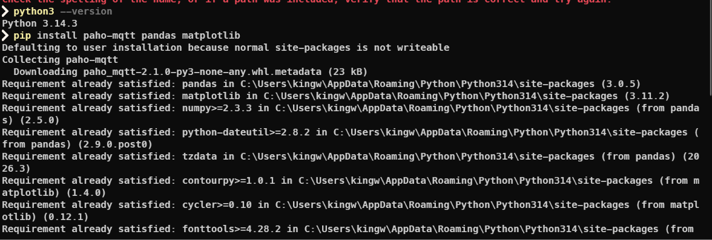
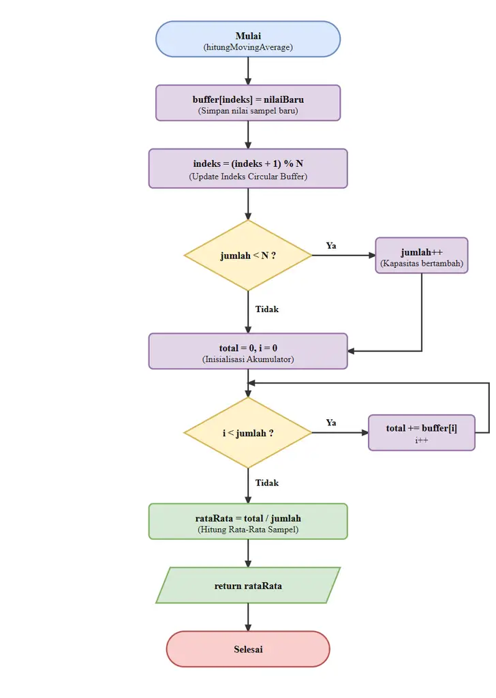
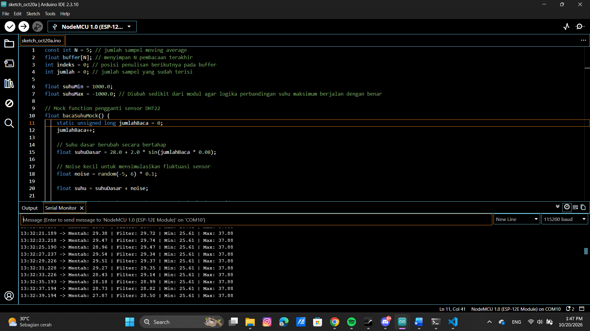
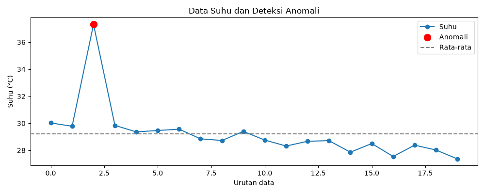

# DOKUMENTASI MODUL 5

Dokumentasi lengkap hasil praktikum Pemrosesan Data Sensor dan Analisis Statistik (Modul 5):

---

## 1. Instalasi Library Python Pendukung

*Gambar 1: Proses instalasi pustaka Python yang diperlukan (`paho-mqtt`, `pandas`, dan `matplotlib`) melalui pip.*

---

## 2. Diagram Alur (Flowchart) Algoritma Moving Average

*Gambar 2: Diagram alur (flowchart) fungsi `hitungMovingAverage()` menggunakan circular buffer berukuran N = 5 dengan operasi modulo `(indeks + 1) % N` berbobot komputasi O(1).*

---

## 3. Hasil Pengamatan Percobaan 5A (Edge Processing pada ESP)

*Gambar 3: Tampilan Serial Monitor Arduino IDE pada Percobaan 5A. Menampilkan perbandingan suhu mentah, suhu terfilter Moving Average, serta pelacakan nilai minimum dan maksimum.*

---

## 4. Hasil Pengamatan Percobaan 5B (Server Processing pada Python)
### A. Serial Monitor Pengirim ESP (Publisher MQTT)

*Gambar 4: Serial Monitor mikrokontroler mempublikasikan format JSON `{"suhu":...}` secara berkala setiap 5 detik ke broker HiveMQ.*

### B. Output Terminal Program Python (Subscriber & Analisis Z-Score)

*Gambar 5: Output terminal eksekusi program Python. Menampilkan penerimaan 20 data sampel secara real-time, penyimpanan ke `data_suhu.csv`, perhitungan mean & standar deviasi, dan deteksi anomali Z-score.*

### C. Visualisasi Grafik Runtun Waktu dan Titik Anomali

*Gambar 6: Grafik runtun waktu data suhu hasil visualisasi Matplotlib yang menonjolkan titik data anomali (lingkaran merah, sampel ke-3 suhu 37.32 °C) dan garis batas rata-rata.*
